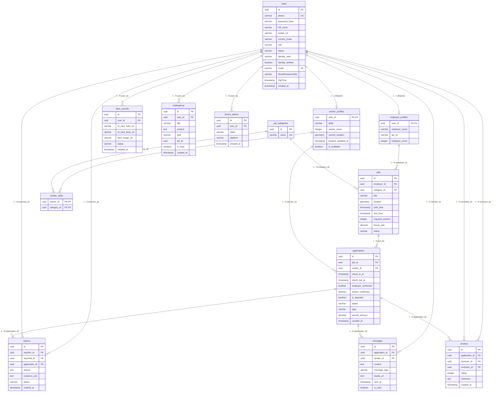

# Tài liệu Cấu trúc Cơ sở Dữ liệu & Thực thể (Entities Documentation) - AntGo / FlashJob

Tài liệu này phản ánh **chính xác 100%** kiến trúc cơ sở dữ liệu và các lớp thực thể (JPA Entities) trong mã nguồn backend của hệ thống kết nối việc làm tức thì **AntGo** (Spring Boot 3 + PostgreSQL + PostGIS).

---

## 1. Tổng quan Kiến trúc Dữ liệu

- **Hệ quản trị CSDL:** PostgreSQL 15+ tích hợp mở rộng không gian **PostGIS** (`GEOMETRY(Point, 4326)`).
- **Khóa chính (Primary Key):** Hầu hết các bảng sử dụng **UUID** tự sinh ngẫu nhiên (`@GeneratedValue(strategy = GenerationType.UUID)`), trừ các bảng mở rộng profile sử dụng chung khóa chính (`@MapsId`).
- **Tổng số thực thể:** 13 thực thể chính + 1 lớp Composite PK (`WorkerSkillIdEntity`).
- **Thời gian (Timestamps):** Tất cả các mốc thời gian sử dụng kiểu dữ liệu `LocalDateTime` (tương ứng `TIMESTAMP` trong SQL), múi giờ chuẩn hệ thống.

---

## 2. Sơ đồ Quan hệ Thực thể (ERD - Entity Relationship Diagram)

---

## 3. Danh sách Chi tiết 13 Thực thể (JPA Entities)

### 3.1. UserEntity (`users`)
Bảng gốc quản lý thông tin định danh, tài khoản bảo mật và phân quyền hệ thống cho toàn bộ người dùng (bao gồm Người tìm việc, Nhà tuyển dụng và Quản trị viên).

- **Java Class:** `com.flashjobweb.entity.UserEntity`
- **Tên bảng CSDL:** `users`

| Tên Cột | Kiểu Dữ Liệu SQL | Nullable | Giá Trị Mặc Định | Ràng Buộc | Mô Tả Chức Năng |
|---|---|---|---|---|---|
| `id` | `UUID` | No | Tự sinh | Primary Key | Khóa chính định danh tài khoản người dùng |
| `phone` | `VARCHAR(20)` | No | | UNIQUE | Số điện thoại duy nhất, dùng để đăng nhập và nhận diện |
| `password_hash` | `VARCHAR(255)` | No | | | Mật khẩu tài khoản đã được mã hóa bằng thuật toán BCrypt |
| `full_name` | `VARCHAR(150)` | No | | | Họ tên đầy đủ của người dùng |
| `avatar_url` | `VARCHAR(500)` | Yes | `null` | | Link ảnh đại diện (lưu trữ trên Google Drive hoặc Cloud) |
| `current_mode` | `VARCHAR(10)` | Yes | `'WORKER'` | | Chế độ người dùng đang bật trong phiên: `WORKER` hoặc `EMPLOYER` |
| `role` | `VARCHAR(20)` | Yes | `'USER'` | | Quyền hạn tài khoản: `USER` hoặc `ROLE_ADMIN` |
| `status` | `VARCHAR(10)` | Yes | `'ACTIVE'` | | Trạng thái tài khoản: `ACTIVE` (hoạt động), `BANNED` (bị khóa) |
| `identity_card` | `VARCHAR(20)` | Yes | `null` | | Số Căn cước công dân / CMND |
| `identity_verified`| `BOOLEAN` | Yes | `false` | | Trạng thái xác thực danh tính eKYC (true = đã duyệt xác thực) |
| `email` | `VARCHAR(255)` | Yes | `null` | UNIQUE | Email cá nhân (dùng nhận thông báo, khôi phục mật khẩu) |
| `ResetPasswordOtp` | `VARCHAR(255)` | Yes | `null` | | Mã OTP dùng xác thực yêu cầu đặt lại mật khẩu |
| `OtpTime` | `TIMESTAMP` | Yes | `null` | | Thời điểm tạo / hết hạn của mã OTP quên mật khẩu |
| `created_at` | `TIMESTAMP` | No | `now()` | Updatable = false | Thời điểm đăng ký tài khoản |

**Các mối quan hệ JPA:**
- `@OneToMany(mappedBy = "user")` $\rightarrow$ `List<NotificationEntity> notifications`: Danh sách thông báo gửi đến người dùng này.
- `@OneToMany(mappedBy = "user")` $\rightarrow$ `List<DeviceTokenEntity> deviceTokens`: Danh sách token thiết bị FCM phục vụ gửi Push Notification.
- `@OneToMany(mappedBy = "reporter")` $\rightarrow$ `List<ReportEntity> reportsMade`: Danh sách các phiếu khiếu nại do người dùng này khởi tạo.
- `@OneToMany(mappedBy = "reported")` $\rightarrow$ `List<ReportEntity> reportsReceived`: Danh sách các phiếu khiếu nại nhắm vào người dùng này.
- `@OneToMany(mappedBy = "reviewer")` $\rightarrow$ `List<ReviewEntity> reviewsGiven`: Danh sách các lượt đánh giá do người dùng này để lại.
- `@OneToMany(mappedBy = "reviewee")` $\rightarrow$ `List<ReviewEntity> reviewsReceived`: Danh sách các lượt đánh giá nhận được từ người khác.
- `@OneToMany(mappedBy = "sender")` $\rightarrow$ `List<MessageEntity> messagesSent`: Danh sách tin nhắn trò chuyện người dùng đã gửi.

---

### 3.2. EkycEntity (`ekyc_records`)
Bảng ghi nhận hồ sơ xác minh danh tính điện tử (eKYC) của người dùng gửi lên để ban quản trị viên duyệt.

- **Java Class:** `com.flashjobweb.entity.EkycEntity`
- **Tên bảng CSDL:** `ekyc_records`

| Tên Cột | Kiểu Dữ Liệu SQL | Nullable | Giá Trị Mặc Định | Ràng Buộc | Mô Tả Chức Năng |
|---|---|---|---|---|---|
| `id` | `UUID` | No | Tự sinh | Primary Key | Khóa chính định danh bản ghi eKYC |
| `user_id` | `UUID` | No | | Foreign Key $\rightarrow$ `users(id)` | Người dùng nộp hồ sơ eKYC |
| `id_card_front_url`| `VARCHAR(500)` | Yes | `null` | | URL ảnh chụp mặt trước Căn cước công dân |
| `id_card_back_url` | `VARCHAR(500)` | Yes | `null` | | URL ảnh chụp mặt sau Căn cước công dân |
| `face_image_url` | `VARCHAR(500)` | Yes | `null` | | URL ảnh chụp chân dung khuôn mặt thực tế |
| `status` | `VARCHAR(20)` | Yes | `'PENDING'` | | Trạng thái xét duyệt: `PENDING`, `APPROVED`, `REJECTED` |
| `created_at` | `TIMESTAMP` | Yes | `now()` | | Thời điểm gửi hồ sơ eKYC |

**Các mối quan hệ JPA:**
- `@ManyToOne(fetch = FetchType.LAZY)` $\rightarrow$ `UserEntity user`: Tham chiếu đến tài khoản người dùng gửi hồ sơ eKYC (`@JoinColumn(name = "user_id")`).

---

### 3.3. EmployerProfileEntity (`employer_profiles`)
Bảng hồ sơ mở rộng dành riêng cho Người tuyển dụng / Doanh nghiệp. Sử dụng chung khóa chính với tài khoản `users`.

- **Java Class:** `com.flashjobweb.entity.EmployerProfileEntity`
- **Tên bảng CSDL:** `employer_profiles`

| Tên Cột | Kiểu Dữ Liệu SQL | Nullable | Giá Trị Mặc Định | Ràng Buộc | Mô Tả Chức Năng |
|---|---|---|---|---|---|
| `user_id` | `UUID` | No | | PK, FK $\rightarrow$ `users(id)` | Khóa chính đồng thời là khóa ngoại liên kết 1-1 với `users.id` qua `@MapsId` |
| `employer_name` | `VARCHAR(150)` | Yes | `null` | | Tên tổ chức, doanh nghiệp, hộ kinh doanh hoặc tên đại diện tuyển dụng |
| `tax_id` | `VARCHAR(20)` | Yes | `null` | | Mã số thuế doanh nghiệp (nếu có) |
| `employer_score` | `INTEGER` | Yes | `100` | | Điểm uy tín nhà tuyển dụng (thang khởi điểm 100, tăng/giảm theo đánh giá và hoàn thành hợp đồng) |

**Các mối quan hệ JPA:**
- `@OneToOne` `@MapsId` `@JoinColumn(name = "user_id")` $\rightarrow$ `UserEntity userEntity`: Liên kết 1-1 chặt chẽ với bản ghi người dùng.
- `@OneToMany(mappedBy = "employer", cascade = CascadeType.ALL, fetch = FetchType.LAZY)` $\rightarrow$ `List<JobEntity> jobs`: Danh sách các tin tuyển dụng việc làm do nhà tuyển dụng này đăng tải.

---

### 3.4. WorkerProfileEntity (`worker_profiles`)
Bảng hồ sơ mở rộng dành cho Người tìm việc / Lao động tự do. Quản lý trạng thái sẵn sàng, kỹ năng và tọa độ GPS thời gian thực.

- **Java Class:** `com.flashjobweb.entity.WorkerProfileEntity`
- **Tên bảng CSDL:** `worker_profiles`

| Tên Cột | Kiểu Dữ Liệu SQL | Nullable | Giá Trị Mặc Định | Ràng Buộc | Mô Tả Chức Năng |
|---|---|---|---|---|---|
| `user_id` | `UUID` | No | | PK, FK $\rightarrow$ `users(id)` | Khóa chính đồng thời là khóa ngoại liên kết 1-1 với `users.id` qua `@MapsId` |
| `skills` | `VARCHAR(255)` | Yes | `null` | | Đoạn văn bản mô tả kỹ năng tự do của người lao động |
| `worker_score` | `INTEGER` | Yes | `100` | | Điểm uy tín lao động (khởi điểm 100, bị trừ điểm khi hủy ca, no-show hoặc bị đánh giá thấp) |
| `current_location`| `GEOMETRY(Point, 4326)` | Yes | `null` | PostGIS SRID 4326 | Tọa độ địa lý GPS hiện tại (kinh độ Longitude, vĩ độ Latitude) |
| `location_updated_at`| `TIMESTAMP` | Yes | `null` | | Thời điểm cập nhật vị trí GPS lần gần nhất |
| `is_available` | `BOOLEAN` | Yes | `false` | | Cờ công tắc bật/tắt trạng thái sẵn sàng nhận việc nhanh (radar tìm việc) |

**Các mối quan hệ JPA:**
- `@OneToOne` `@MapsId` `@JoinColumn(name = "user_id")` $\rightarrow$ `UserEntity userEntity`: Liên kết 1-1 chia sẻ PK với `users`.
- `@OneToMany(mappedBy = "worker", cascade = CascadeType.ALL, fetch = FetchType.LAZY)` $\rightarrow$ `List<ApplicationEntity> applications`: Danh sách tất cả các đơn ứng tuyển/lời mời làm việc của lao động.
- `@OneToMany(mappedBy = "worker", cascade = CascadeType.ALL, fetch = FetchType.LAZY)` $\rightarrow$ `List<WorkerSkillEntity> workerSkills`: Danh mục các nhóm kỹ năng nghề nghiệp mà lao động đăng ký.

---

### 3.5. JobCategoryEntity (`job_categories`)
Bảng danh mục ngành nghề công việc (ví dụ: Bốc xếp hàng hóa, Phục vụ nhà hàng, Tạp vụ vệ sinh, Shipper, Bảo vệ...).

- **Java Class:** `com.flashjobweb.entity.JobCategoryEntity`
- **Tên bảng CSDL:** `job_categories`

| Tên Cột | Kiểu Dữ Liệu SQL | Nullable | Giá Trị Mặc Định | Ràng Buộc | Mô Tả Chức Năng |
|---|---|---|---|---|---|
| `id` | `UUID` | No | Tự sinh | Primary Key | Mã định danh danh mục công việc |
| `name` | `VARCHAR(100)` | No | | UNIQUE | Tên loại công việc, duy nhất không trùng lặp |

**Các mối quan hệ JPA:**
- `@OneToMany(mappedBy = "category")` $\rightarrow$ `List<JobEntity> jobs`: Danh sách các công việc thuộc danh mục này.
- `@OneToMany(mappedBy = "category")` $\rightarrow$ `List<WorkerSkillEntity> workerSkills`: Danh sách liên kết kỹ năng của các worker với danh mục này.

---

### 3.6. JobEntity (`jobs`)
Bảng tin đăng tuyển dụng ca làm việc thời vụ tức thì. Có tọa độ không gian PostGIS phục vụ tìm kiếm theo bán kính lân cận (Radar / Nearby search).

- **Java Class:** `com.flashjobweb.entity.JobEntity`
- **Tên bảng CSDL:** `jobs`

| Tên Cột | Kiểu Dữ Liệu SQL | Nullable | Giá Trị Mặc Định | Ràng Buộc | Mô Tả Chức Năng |
|---|---|---|---|---|---|
| `id` | `UUID` | No | Tự sinh | Primary Key | Khóa chính bài đăng tuyển dụng |
| `employer_id` | `UUID` | No | | Foreign Key $\rightarrow$ `employer_profiles(user_id)` | Nhà tuyển dụng tạo bài đăng |
| `category_id` | `UUID` | Yes | `null` | Foreign Key $\rightarrow$ `job_categories(id)` | Nhóm ngành nghề của công việc |
| `title` | `VARCHAR(200)` | No | | | Tiêu đề tóm tắt ca làm việc |
| `location` | `GEOMETRY(Point, 4326)` | No | | PostGIS SRID 4326 | Tọa độ GPS nơi làm việc (kinh độ, vĩ độ) |
| `start_time` | `TIMESTAMP` | No | | | Thời gian bắt đầu ca làm việc |
| `end_time` | `TIMESTAMP` | No | | | Thời gian kết thúc ca làm việc |
| `required_workers`| `INTEGER` | Yes | `1` | | Số lượng nhân sự cần tuyển cho ca làm |
| `hourly_rate` | `DECIMAL(10,2)`| No | | | Mức thù lao trả theo giờ (VNĐ/giờ) |
| `status` | `VARCHAR(15)` | No | `'OPEN'` | | Trạng thái tin tuyển: `OPEN`, `IN_PROGRESS`, `COMPLETED`, `CANCELLED` |

**Các mối quan hệ JPA:**
- `@ManyToOne(fetch = FetchType.LAZY)` $\rightarrow$ `EmployerProfileEntity employer`: Người tuyển dụng tạo tin (`@JoinColumn(name = "employer_id")`).
- `@ManyToOne(fetch = FetchType.LAZY)` $\rightarrow$ `JobCategoryEntity category`: Danh mục công việc (`@JoinColumn(name = "category_id")`).
- `@OneToMany(mappedBy = "job", cascade = CascadeType.ALL, fetch = FetchType.LAZY)` $\rightarrow$ `List<ApplicationEntity> applications`: Danh sách đơn xin việc hoặc thư mời làm việc của công việc này.

---

### 3.7. ApplicationEntity (`applications`)
Bảng quản lý hợp đồng/đơn ứng tuyển hoặc lời mời làm việc giữa Nhà tuyển dụng và Người lao động. Là thực thể cốt lõi cho quy trình Check-in QR, Check-out, quyết toán thù lao và khởi tạo kênh chat/đánh giá.

- **Java Class:** `com.flashjobweb.entity.ApplicationEntity`
- **Tên bảng CSDL:** `applications`
- **Ràng buộc duy nhất:** `@UniqueConstraint(columnNames = {"job_id", "worker_id"})` — Mỗi lao động chỉ được có 1 hồ sơ duy nhất cho mỗi bài đăng việc.

| Tên Cột | Kiểu Dữ Liệu SQL | Nullable | Giá Trị Mặc Định | Ràng Buộc | Mô Tả Chức Năng |
|---|---|---|---|---|---|
| `id` | `UUID` | No | Tự sinh | Primary Key | Khóa chính đơn ứng tuyển |
| `job_id` | `UUID` | No | | Foreign Key $\rightarrow$ `jobs(id)` | Công việc được ứng tuyển / mời làm |
| `worker_id` | `UUID` | No | | Foreign Key $\rightarrow$ `worker_profiles(user_id)` | Lao động tham gia ứng tuyển / nhận lời mời |
| `check_in_at` | `TIMESTAMP` | Yes | `null` | | Thời điểm lao động quét mã QR xác thực đến điểm làm việc |
| `check_out_at` | `TIMESTAMP` | Yes | `null` | | Thời điểm quét mã kết thúc ca làm |
| `employer_confirmed`| `BOOLEAN` | Yes | `false` | | Employer đã xác nhận hoàn thành công việc |
| `worker_confirmed` | `BOOLEAN` | Yes | `false` | | Worker đã xác nhận hoàn tất ca làm việc |
| `is_disputed` | `BOOLEAN` | Yes | `false` | | Đánh dấu ca làm đang có khiếu nại / tranh chấp tiền công |
| `status` | `VARCHAR(255)` | Yes | `'PENDING'` | Enum `ApplicationStatus` | `PENDING`, `BOOKED`, `IN_PROGRESS`, `CANCELLED`, `NO_SHOW`, `COMPLETED` |
| `type` | `VARCHAR(255)` | No | | Enum `ApplicationType` | `INVITATION` (Nhà tuyển dụng chủ động mời) hoặc `APPLICATION` (Lao động tự nộp đơn) |
| `earned_amount` | `DECIMAL(19,2)`| Yes | `null` | | Số tiền thực nhận tính toán theo số giờ làm việc thực tế |
| `created_at` | `TIMESTAMP` | Yes | `now()` | | Thời điểm tạo đơn ứng tuyển / gửi lời mời |

**Các mối quan hệ JPA:**
- `@ManyToOne(fetch = FetchType.LAZY)` $\rightarrow$ `JobEntity job`: Tin tuyển dụng gốc (`@JoinColumn(name = "job_id")`).
- `@ManyToOne(fetch = FetchType.LAZY)` $\rightarrow$ `WorkerProfileEntity worker`: Lao động tham gia (`@JoinColumn(name = "worker_id")`).
- `@OneToMany(mappedBy = "application")` $\rightarrow$ `List<MessageEntity> messages`: Toàn bộ tin nhắn trao đổi trong phạm vi công việc này.
- `@OneToMany(mappedBy = "application")` $\rightarrow$ `List<ReviewEntity> reviews`: Đánh giá 2 chiều (Chủ $\leftrightarrow$ Thợ) sau khi hoàn tất.
- `@OneToMany(mappedBy = "application")` $\rightarrow$ `List<ReportEntity> reports`: Các khiếu nại tố cáo phát sinh liên quan đến ca làm này.

---

### 3.8. MessageEntity (`messages`)
Bảng lưu trữ lịch sử tin nhắn trò chuyện trực tiếp (Chat thời gian thực qua WebSocket) giữa Nhà tuyển dụng và Người lao động trong phạm vi một ca làm (`Application`).

- **Java Class:** `com.flashjobweb.entity.MessageEntity`
- **Tên bảng CSDL:** `messages`

| Tên Cột | Kiểu Dữ Liệu SQL | Nullable | Giá Trị Mặc Định | Ràng Buộc | Mô Tả Chức Năng |
|---|---|---|---|---|---|
| `id` | `UUID` | No | Tự sinh | Primary Key | Khóa chính tin nhắn |
| `application_id` | `UUID` | No | | Foreign Key $\rightarrow$ `applications(id)` | Hợp đồng / ca làm diễn ra cuộc hội thoại |
| `sender_id` | `UUID` | No | | Foreign Key $\rightarrow$ `users(id)` | Người gửi tin nhắn |
| `content` | `TEXT` | No | | | Nội dung văn bản tin nhắn |
| `message_type` | `VARCHAR(20)` | Yes | `'TEXT'` | | Phân loại tin nhắn: `TEXT` (chữ), `IMAGE` (ảnh), `LOCATION` |
| `media_url` | `TEXT` | Yes | `null` | | Link file ảnh hoặc đính kèm lưu trên Google Drive |
| `sent_at` | `TIMESTAMP` | Yes | `now()` | | Thời điểm tin nhắn được gửi đi |
| `is_read` | `BOOLEAN` | Yes | `false` | | Cờ trạng thái đối phương đã xem tin nhắn hay chưa |

**Các mối quan hệ JPA:**
- `@ManyToOne(fetch = FetchType.LAZY)` $\rightarrow$ `ApplicationEntity application`: Tham chiếu đến phiên làm việc (`@JoinColumn(name = "application_id")`).
- `@ManyToOne(fetch = FetchType.LAZY)` $\rightarrow$ `UserEntity sender`: Tham chiếu đến người gửi (`@JoinColumn(name = "sender_id")`).

---

### 3.9. NotificationEntity (`notifications`)
Bảng thông báo hệ thống gửi đến người dùng (thông báo có người ứng tuyển, lời mời làm việc, thông báo check-in, tin nhắn mới, kết quả eKYC...).

- **Java Class:** `com.flashjobweb.entity.NotificationEntity`
- **Tên bảng CSDL:** `notifications`

| Tên Cột | Kiểu Dữ Liệu SQL | Nullable | Giá Trị Mặc Định | Ràng Buộc | Mô Tả Chức Năng |
|---|---|---|---|---|---|
| `id` | `UUID` | No | Tự sinh | Primary Key | Khóa chính thông báo |
| `user_id` | `UUID` | No | | Foreign Key $\rightarrow$ `users(id)` | Người nhận thông báo |
| `title` | `VARCHAR(150)` | No | | | Tiêu đề thông báo ngắn gọn |
| `content` | `TEXT` | Yes | `null` | | Nội dung chi tiết của thông báo |
| `type` | `VARCHAR(20)` | No | | | Phân loại thông báo (`APPLICATION`, `JOB`, `SYSTEM`, `CHAT`, `EKYC`, `REPORT`) |
| `job_id` | `UUID` | Yes | `null` | | ID công việc liên quan (hỗ trợ người dùng nhấn vào để chuyển hướng ngay) |
| `is_read` | `BOOLEAN` | Yes | `false` | | Đã đọc thông báo hay chưa (chấm đỏ thông báo) |
| `created_at` | `TIMESTAMP` | No | `now()` | Updatable = false | Thời điểm tạo thông báo |

**Các mối quan hệ JPA:**
- `@ManyToOne(fetch = FetchType.LAZY)` $\rightarrow$ `UserEntity user`: Tài khoản nhận thông báo (`@JoinColumn(name = "user_id")`).

---

### 3.10. ReportEntity (`reports`)
Bảng ghi nhận báo cáo sai phạm, gian lận, không đến làm hoặc vi phạm thỏa thuận giữa các người dùng với nhau.

- **Java Class:** `com.flashjobweb.entity.ReportEntity`
- **Tên bảng CSDL:** `reports`

| Tên Cột | Kiểu Dữ Liệu SQL | Nullable | Giá Trị Mặc Định | Ràng Buộc | Mô Tả Chức Năng |
|---|---|---|---|---|---|
| `id` | `UUID` | No | Tự sinh | Primary Key | Khóa chính bản ghi khiếu nại |
| `reporter_id` | `UUID` | No | | Foreign Key $\rightarrow$ `users(id)` | Người tạo đơn khiếu nại |
| `reported_id` | `UUID` | No | | Foreign Key $\rightarrow$ `users(id)` | Người bị khiếu nại |
| `application_id` | `UUID` | Yes | `null` | Foreign Key $\rightarrow$ `applications(id)` | Hợp đồng công việc xảy ra sự vụ (nếu có) |
| `reason` | `TEXT` | No | | | Nội dung lý do và diễn giải sự việc khiếu nại |
| `evidence_urls` | `TEXT` | Yes | `null` | | Chuỗi JSON hoặc danh sách URL ảnh chứng cứ lưu trữ Google Drive |
| `status` | `VARCHAR(15)` | No | `'PENDING'` | | Trạng thái xử lý của Admin: `PENDING` (chờ xử lý), `RESOLVED` (chấp thuận), `REJECTED` (bác bỏ) |
| `created_at` | `TIMESTAMP` | Yes | `now()` | | Thời điểm nộp khiếu nại |

**Các mối quan hệ JPA:**
- `@ManyToOne(fetch = FetchType.LAZY)` $\rightarrow$ `UserEntity reporter`: Người nộp đơn (`@JoinColumn(name = "reporter_id")`).
- `@ManyToOne(fetch = FetchType.LAZY)` $\rightarrow$ `UserEntity reported`: Người bị tố giác (`@JoinColumn(name = "reported_id")`).
- `@ManyToOne(fetch = FetchType.LAZY)` $\rightarrow$ `ApplicationEntity application`: Ca làm việc liên đới (`@JoinColumn(name = "application_id")`).

---

### 3.11. ReviewEntity (`reviews`)
Bảng nhận xét và chấm điểm sao sau khi hoàn thành ca làm việc. Hỗ trợ đánh giá 2 chiều (Chủ đánh giá Thợ và Thợ đánh giá Chủ).

- **Java Class:** `com.flashjobweb.entity.ReviewEntity`
- **Tên bảng CSDL:** `reviews`
- **Ràng buộc duy nhất:** `@UniqueConstraint(columnNames = {"application_id", "reviewer_id"})` — Một người chỉ được để lại 1 đánh giá cho mỗi ca làm việc hoàn thành.

| Tên Cột | Kiểu Dữ Liệu SQL | Nullable | Giá Trị Mặc Định | Ràng Buộc | Mô Tả Chức Năng |
|---|---|---|---|---|---|
| `id` | `UUID` | No | Tự sinh | Primary Key | Khóa chính bản ghi đánh giá |
| `application_id` | `UUID` | No | | Foreign Key $\rightarrow$ `applications(id)` | Ca làm việc được đánh giá |
| `reviewer_id` | `UUID` | No | | Foreign Key $\rightarrow$ `users(id)` | Người gửi đánh giá |
| `reviewee_id` | `UUID` | No | | Foreign Key $\rightarrow$ `users(id)` | Người được nhận đánh giá |
| `rating` | `INTEGER` | No | | $1 \le \text{rating} \le 5$ | Số sao đánh giá độ hài lòng |
| `comment` | `TEXT` | Yes | `null` | | Lời bình luận / nhận xét trải nghiệm làm việc |
| `created_at` | `TIMESTAMP` | No | `now()` | Updatable = false | Thời điểm đăng đánh giá |

**Các mối quan hệ JPA:**
- `@ManyToOne(fetch = FetchType.LAZY)` $\rightarrow$ `ApplicationEntity application`: Ca làm liên đới (`@JoinColumn(name = "application_id")`).
- `@ManyToOne(fetch = FetchType.LAZY)` $\rightarrow$ `UserEntity reviewer`: Người viết đánh giá (`@JoinColumn(name = "reviewer_id")`).
- `@ManyToOne(fetch = FetchType.LAZY)` $\rightarrow$ `UserEntity reviewee`: Người nhận đánh giá (`@JoinColumn(name = "reviewee_id")`).

---

### 3.12. WorkerSkillEntity (`worker_skills`) & WorkerSkillIdEntity
Bảng trung gian thể hiện quan hệ nhiều - nhiều ($N-N$) giữa `WorkerProfile` và `JobCategory`, giúp thợ chọn nhiều danh mục nghề nghiệp phù hợp với khả năng của mình để nhận thông báo việc.

- **Java Class:** `com.flashjobweb.entity.WorkerSkillEntity`
- **Composite ID Class:** `com.flashjobweb.entity.WorkerSkillIdEntity` (Triển khai `Serializable`, `equals()`, `hashCode()`)
- **Tên bảng CSDL:** `worker_skills`

| Tên Cột | Kiểu Dữ Liệu SQL | Nullable | Giá Trị Mặc Định | Ràng Buộc | Mô Tả Chức Năng |
|---|---|---|---|---|---|
| `worker_id` | `UUID` | No | | PK, FK $\rightarrow$ `worker_profiles(user_id)` | Khóa chính hợp phần 1 (ID lao động) |
| `category_id` | `UUID` | No | | PK, FK $\rightarrow$ `job_categories(id)` | Khóa chính hợp phần 2 (ID danh mục nghề) |

**Các mối quan hệ JPA:**
- `@IdClass(WorkerSkillIdEntity.class)`: Định danh khóa chính phức hợp gồm `(worker_id, category_id)`.
- `@ManyToOne(fetch = FetchType.LAZY)` `@JoinColumn(name = "worker_id", insertable = false, updatable = false)` $\rightarrow$ `WorkerProfileEntity worker`.
- `@ManyToOne(fetch = FetchType.LAZY)` `@JoinColumn(name = "category_id", insertable = false, updatable = false)` $\rightarrow$ `JobCategoryEntity category`.

---

### 3.13. DeviceTokenEntity (`device_tokens`)
Bảng lưu trữ token đăng ký của thiết bị (Firebase Cloud Messaging - FCM Token) để phục vụ việc gửi thông báo đẩy (Push Notification) lên thiết bị di động và trình duyệt web.

- **Java Class:** `com.flashjobweb.entity.DeviceTokenEntity`
- **Tên bảng CSDL:** `device_tokens`
- **Ràng buộc duy nhất:** `@UniqueConstraint(columnNames = {"user_id", "token"})` — Chống lưu trùng token cho cùng một tài khoản.

| Tên Cột | Kiểu Dữ Liệu SQL | Nullable | Giá Trị Mặc Định | Ràng Buộc | Mô Tả Chức Năng |
|---|---|---|---|---|---|
| `id` | `UUID` | No | Tự sinh | Primary Key | Khóa chính định danh thiết bị |
| `user_id` | `UUID` | No | | Foreign Key $\rightarrow$ `users(id)` | Tài khoản sở hữu thiết bị này |
| `token` | `VARCHAR(500)` | No | | | Mã token FCM thiết bị |
| `platform` | `VARCHAR(10)` | No | | | Nền tảng thiết bị: `WEB`, `ANDROID`, `IOS` |
| `created_at` | `TIMESTAMP` | No | `now()` | Updatable = false | Thời điểm thiết bị đăng ký token |

**Các mối quan hệ JPA:**
- `@ManyToOne(fetch = FetchType.LAZY)` $\rightarrow$ `UserEntity user`: Chủ sở hữu token (`@JoinColumn(name = "user_id")`).

---

## 4. Bảng Định nghĩa Enums & Hằng số Nghiệp vụ (Enums & Constants)

### 4.1. `ApplicationStatus` (`com.flashjobweb.util.ApplicationStatus`)
Quản lý vòng đời trạng thái của một đơn ứng tuyển hoặc lời mời làm việc:

| Giá Trị Enum | Ý Nghĩa Nghiệp Vụ |
|---|---|
| `PENDING` | Vừa gửi lời mời hoặc đơn ứng tuyển, đang chờ đối phương xem xét & đồng ý. |
| `BOOKED` | Ứng viên hoặc Nhà tuyển dụng đã đồng ý nhận việc, lịch làm việc đã được chốt (chuẩn bị ca làm). |
| `IN_PROGRESS` | Ca làm đang diễn ra (Worker đã check-in thành công qua quét mã QR). |
| `CANCELLED` | Đã hủy (bởi ứng viên hoặc nhà tuyển dụng trước hoặc trong khi bắt đầu). |
| `NO_SHOW` | Ứng viên không đến điểm hẹn như cam kết (bị trừ điểm uy tín nghiêm trọng). |
| `COMPLETED` | Ca làm đã kết thúc, hai bên đã xác nhận hoàn thành và tính toán tiền công. |

### 4.2. `ApplicationType` (`com.flashjobweb.util.ApplicationType`)
Phân loại chiều phát sinh hợp đồng:

| Giá Trị Enum | Ý Nghĩa Nghiệp Vụ |
|---|---|
| `INVITATION` | **Nhà tuyển dụng chủ động gửi lời mời** cho người lao động (sau khi tìm thấy thợ phù hợp trên bản đồ Radar). |
| `APPLICATION` | **Người lao động chủ động nộp đơn ứng tuyển** vào tin đăng tuyển của nhà tuyển dụng. |

### 4.3. Các giá trị trạng thái chuỗi khác (String Domain Constants)

- **`UserEntity.role`:**
  - `USER`: Người dùng thông thường (có thể đóng cả vai trò Worker và Employer).
  - `ROLE_ADMIN`: Quản trị viên cấp cao có quyền truy cập trang quản trị admin, kiểm duyệt eKYC, xử lý khiếu nại và quản lý tài khoản.
- **`UserEntity.currentMode`:**
  - `WORKER`: Đang ở giao diện / chế độ Thợ tìm việc.
  - `EMPLOYER`: Đang ở giao diện / chế độ Nhà tuyển dụng.
- **`UserEntity.status`:**
  - `ACTIVE`: Tài khoản hoạt động bình thường.
  - `BANNED`: Tài khoản bị quản trị viên cấm hoạt động do vi phạm chính sách hoặc điểm uy tín quá thấp.
- **`EkycEntity.status`:**
  - `PENDING`: Đang chờ Admin xét duyệt hồ sơ giấy tờ.
  - `APPROVED`: Hồ sơ hợp lệ, đã xác nhận danh tính thành công (`users.identity_verified = true`).
  - `REJECTED`: Hồ sơ bị từ chối do mờ, không khớp hoặc không hợp lệ.
- **`JobEntity.status`:**
  - `OPEN`: Đang mở đăng tuyển, chờ lao động ứng tuyển.
  - `IN_PROGRESS`: Đã tuyển đủ quân số hoặc đã đến giờ làm, ca đang diễn ra.
  - `COMPLETED`: Ca làm việc đã kết thúc hoàn toàn.
  - `CANCELLED`: Bài đăng đã bị chủ việc hủy bỏ.
- **`ReportEntity.status`:**
  - `PENDING`: Đơn khiếu nại đang chờ Admin giải quyết.
  - `RESOLVED`: Khiếu nại đã được Admin giải quyết thỏa đáng (có thể xử phạt tài khoản vi phạm).
  - `REJECTED`: Khiếu nại không đủ căn cứ và bị bác bỏ.
- **`MessageEntity.message_type`:**
  - `TEXT`: Tin nhắn văn bản thuần túy.
  - `IMAGE`: Tin nhắn hình ảnh (đính kèm link Google Drive).
- **`DeviceTokenEntity.platform`:**
  - `WEB`: Trình duyệt web máy tính / điện thoại.
  - `ANDROID`: Thiết bị di động hệ điều hành Android.
  - `IOS`: Thiết bị di động hệ điều hành iOS.

---

## 5. Quy tắc Ràng buộc & Tương tác Dữ liệu Đặc thù

1. **Khóa liên kết 1-1 (`@MapsId`):**
   - Cả `employer_profiles` và `worker_profiles` không tự sinh ID mới mà dùng trực tiếp `user_id` làm khóa chính. Mỗi user chỉ có tối đa 1 profile employer và 1 profile worker.
2. **Không gian PostGIS (`GEOMETRY(Point, 4326)`):**
   - Vị trí của `jobs.location` và `worker_profiles.current_location` sử dụng hệ quy chiếu tọa độ không gian WGS 84 (SRID 4326).
   - Truy vấn tìm việc gần đây hoặc tìm thợ quanh đây sử dụng hàm không gian `ST_DWithin` hoặc `ST_DistanceSphere` của PostGIS giúp đạt hiệu năng cao hơn việc tính toán lượng giác bằng mã Java.
3. **Quy trình Check-in / Check-out QR:**
   - Khi Worker đến địa điểm, Employer cung cấp mã QR chứa mã xác thực ca làm.
   - Worker quét QR $\rightarrow$ Backend cập nhật `applications.check_in_at = now()`, chuyển trạng thái `status = IN_PROGRESS`.
   - Kết thúc ca làm việc $\rightarrow$ `applications.check_out_at = now()`, cập nhật `earned_amount = (thời gian làm thực tế) * jobs.hourly_rate`.
4. **Điểm uy tín tự động:**
   - Khởi tạo ban đầu: `employer_score = 100`, `worker_score = 100`.
   - Mỗi đánh giá 5 sao từ đối tác cộng điểm uy tín; khiếu nại vi phạm được duyệt hoặc đánh dấu `NO_SHOW` sẽ trừ điểm uy tín trực tiếp.
